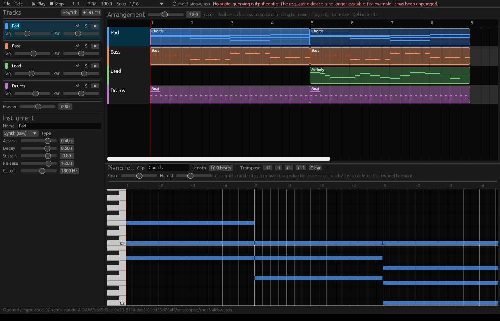

# AIDAW 🎹 —— 哼，给杂鱼准备的 AI 作曲 DAW

> 欸～连和弦都不会写的笨蛋也想做音乐？
> 真拿你没办法……那就让 AI 帮你写，你只要在旁边动动鼠标改改就行了♡
> 才、才不是特意为你做的！只是刚好 Windows 11 上能跑而已！

**AIDAW** 是一个跑在 Windows 11 上的 **AI 驱动 DAW**：AI 通过 [MCP](https://modelcontextprotocol.io) 工具（或者命令行）读写工程、作曲、渲染；你在 GUI 里**实时**看着 AI 一步步改你的歌，不满意就精调，或者直接 `Ctrl+Z` 把它的改动扔掉。



## 现在都能干嘛（给不看代码的杂鱼的速览）

| 功能 | 一句话 |
|---|---|
| 🐣 Easy / 🔧 Pro 开关 | 左上角的大开关。新手默认 Easy，只留必要按钮；觉得自己行了再切 Pro。切换只改界面，不碰你的歌 |
| 🔁 循环播放 | 默认播到最后一个音符所在小节的结尾就绕回开头，杂鱼不用手忙脚乱按停止。想死磕某几小节？在小节号上方那条细条里拖一下就是循环区（A/B 循环）：拖中间挪位置、拖两头改长短、点一下开关，`L` 键或顶栏 🔁 按钮也行。AI 也能用 `set_loop` 帮你圈好，你只管竖起耳朵听♡ |
| ▶️ 从哪儿播都有声 | 从长音、和弦中间开始播放也马上能听到（20 ms 淡入，不会「啪」一声），不用傻等下一个音符 |
| ⚡ 不卡音的引擎 | 音频回调里不加锁、不分配内存，界面再忙也卡不出爆音。哼，本小姐写的引擎才不会掉链子 |
| 🤖 任何 LLM 都能用 | `aidaw-mcp.exe`：29 个 MCP 工具，外加 CLI（`call` / `tools --format openai` / `guide`），Claude、GPT、Gemini、Ollama 都行 |
| 🛡️ AI 不会乱来 | MCP 的相对路径一律相对工程目录，只允许写 `*.aidaw.json` 和 `*.wav`；GUI 和 AI 同时改也不会丢改动 |
| ✨ 好看的界面 | 深色主题、LCD 风格走带、会发光的按钮，内置 Inter 字体 |
| 📐 自适应布局 | 两行顶栏、钢琴卷帘按窗口比例缩放，小窗口（900×600）也不挤 |
| 🌏 EN / 中文 | 顶栏右侧一键切换；首次启动跟随系统语言。内置 Noto Sans SC 子集，不靠系统字体 |
| 🎛️ 78 个音色 + 7 套鼓组 | 10 个分类标签页，从电钢到 808 到 8-bit，挑到你满意为止（反正你也挑不出毛病吧？） |
| 🌌 混响 | 每条轨道一个「混响」滑块，所有轨道共用一个房间（Pro 模式还能调房间大小和音色）。新轨道按音色自动给一点，贝斯默认干声。杂鱼的歌终于不那么干巴巴了♡ |
| ✂️ 像样的编辑 | 按住 `Shift` 拖个框就能选中一堆音符：`Ctrl+C` / `Ctrl+V` 复制粘贴、`Ctrl+D` 重复、方向键挪位置和升降音高（按调内音走，乱按也不跑调）、`Q` 量化。片段也能 `Ctrl+C` / `Ctrl+V` / `Ctrl+D`，按 `S` 在播放头处一刀两段，按住 `Alt` 拖动直接复制一份。音轨拖名字就能换顺序，颜色跟着音轨走（删轨、挪轨都不会乱变色），想换色就点「音色」面板里的小圆点。右键片段、音轨、标尺还有更多。终于不用一个一个点了吧，杂鱼♡ |
| 🎚️ AI 会编曲，还会「听」 | `copy_bars` 把 4 小节复制成一整首，`quantize` 量化还能加摇摆，`humanize` 让死板的音符像真人弹的。`analyze` 把歌在内存里渲染一遍（不写文件），报响度（LUFS）、限幅器、高中低频比例、每条轨单独有多响，哪里不对还直接给出修正的调用。AI 终于不是捂着耳朵写歌了♡ |
| 🎙️ 录音 | 「添加乐器」菜单最下面加一条**音频轨**，点轨道头上的小红圈「待录音」，按 `R`：先响一小节嗒嗒声帮你数拍，然后开录，再按 `R` 或空格停。录音存成 24-bit WAV，乖乖待在歌曲旁边的「<歌名> audio」文件夹里，声卡延迟自动补偿，和伴奏严丝合缝。在旧录音上重录，盖住的部分自动让位，`Ctrl+Z` 一下就回来。节拍器、戴耳机监听、输入电平表也都有。唱跑调可不归本小姐管♡ |
| 🎹 MIDI 键盘 | USB MIDI 键盘插上就能弹（延音踏板也认），弹的是待录音的乐器轨，没有就弹选中的那条；让乐器轨待录音再按 `R`，弹的音符直接录成片段 |
| 🎧 音频片段 | 点一下录音片段，下面就是波形编辑器：拖两边修剪、拖黄色小方块淡入淡出、调音量。编排区里照样能拖、`S` 切开、`Ctrl+D` 复制。「文件 › 导入音频（WAV）」能把现成的 WAV 放进来。导出 WAV 和 `analyze` 都会带上它们 |
| 🔌 ASIO（可选） | 有专业声卡（音频接口）想要更低延迟，可以自己编一个带 ASIO 驱动的版本。默认包里故意没带，为什么看「构建」里的 ASIO 一节 |
| 📈 自动化包络 | 音量、声像、混响、滤波亮度、共振、失真、FM、颤音、Sub、噪声，还有整首歌的总音量和混响房间，都能画成随时间变化的线：淡入淡出、滤波扫频、侧链「泵」感统统安排。AI 用 `automate` 写，你在轨道下面的包络道上点一点、拖一拖就能改。被包络接管的滑块会变灰、跟着播放头动，可不是坏了哦，笨蛋♡ |
| 💬 聊天 AI 直接粘贴 | 什么都不用装：让随便哪个聊天 AI（ChatGPT、Gemini、DeepSeek…）用 JSON 列出音符，复制它的整段回答，点一个片段按 `Ctrl+V`，音符就进来了。现成的提示词在「问 AI」里 |
| 🔊 主总线限幅器 | 峰值限幅 + 软削波，杂鱼把音量推爆也不会炸耳朵 |
| ↩ 撤销一切 | AI 的改动、你的改动，全都能 `Ctrl+Z`。AI 自己也能用 `undo` 撤回它写砸的东西，而且你在 GUI 里改过的话它会乖乖收手，绝不顺手把你的改动一起扔掉 |

## 快速上手

### 0. 拿到程序

- **懒人**：去 [Releases](https://github.com/gamesplayer0813/AIDAW/releases/latest) 下载 `AIDAW-win64.zip`，解压到随便哪个文件夹，双击 `aidaw.exe`。里面还有 `aidaw-mcp.exe`、demo 工程、给 AI 看的说明书和一份 `README.txt`。Windows 弹出「Windows 已保护你的电脑」？点「更多信息」→「仍要运行」，只是 exe 没花钱买签名而已，本小姐才不会害你。
- **想尝鲜的**：每次 CI 都会把最新代码打成同样的包，在 GitHub Actions 里下载 artifact `aidaw-windows-x64`（要登录 GitHub）。
- **想自己编译的**：看下面的「构建」。哼，看你能不能编过。

### 1. 打开 GUI

双击 `aidaw.exe`，或者带上 demo：

```powershell
aidaw.exe examples\demo.aidaw.json
```

第一次打开会有欢迎页，可以选：

- **2 分钟互动教程**：一步步教你播放、画音符、换音色，做对了自动进下一步。连杂鱼都能跟上的那种♡
- 播放 demo / 新建空白歌曲
- 3 步把 Claude 接进来

之后随时在 **❓ Help** 菜单里重开。

### 2. Easy 和 Pro 到底差在哪

- **🐣 Easy**（默认）：大按钮选音色；用「心情」（Happy / Sad / Can't go wrong / Bluesy）代替调式，**音符永远在调内**，乱点也好听；长度按小节算；顶栏直接有 ↩ Undo / ↪ Redo 和 ✨ Ask AI。
- **🔧 Pro**：网格、声像、Solo、力度、缩放，以及音色微调（ADSR、滤波、共振、滤波包络、FM、Unison、Sub、颤音、失真……）。高级参数默认折叠，怕你一打开就晕。

**Key + Stay in key** 会高亮调内音并把音符自动吸附过去。点钢琴键能直接试听，画音符时也能听到声音。每个按钮都有悬停说明，看不懂就把鼠标停上去，笨蛋。

### 3. 音色

内置 **78 个音色**，分 10 组标签页：

键盘（电钢、风琴、羽管键琴…）· 贝斯（808、Acid、Reese…）· 主音 · Pad · 拨弦/吉他 · 钟琴/马林巴 · 管弦（弦乐、铜管、长笛、萨克斯…）· 复古 8-bit · 音效（Riser、Zap…）· 鼓组

**7 套鼓组**：标准 / 808 / 909 / 原声 / Lo-fi / Trap / Electro，全都带牛铃、沙锤、康加等打击乐。

### 4. 快捷键（背下来，不许问第二遍！）

| 操作 | 怎么做 |
|---|---|
| 播放 / 暂停 | `空格` |
| 定位播放头 | 点编排区的标尺 |
| 新建 clip | 编排区双击空白处 |
| 移动 / 改长度 / 删除 clip | 拖动 / 拖右边缘 / 点一下再按 `Del` |
| 复制 clip | 点一下再按 `Ctrl+D`，接在它后面复制一份（后面被占了就放到下一个空位）；`Ctrl+C` / `Ctrl+V` 粘到播放头所在的小节；`←` / `→` 挪一小节；按住 `Alt` 拖动：原来的不动，拖走的是复制品 |
| 切开 clip | 把播放头放进 clip 里按 `S`（Easy 模式切在最近的小节线上，Pro 按网格），或者右键 clip →「从这里切成两段」 |
| 循环区 | 在小节号上方的细条里拖出范围；拖中间挪动、拖两头改长短、点一下开关。`L` 开关循环，第一次按会循环当前选中的 clip。循环打开时停止键回到循环起点 |
| 音轨顺序 / 颜色 | 上下拖动编排区左边的音轨名称，或右键音轨 →「上移 / 下移」；颜色在左侧「音色」面板或右键菜单里挑 |
| 更多操作 | 右键 clip、音轨或标尺，切开、循环、复制、删除都在里面 |
| 画音符 | 钢琴卷帘里点击或拖拽空白处 |
| 选中多个音符 | 按住 `Shift` 在空白处拖个框；`Ctrl+点击` 加选 / 取消；`Ctrl+A` 全选；`Esc` 全不选 |
| 改音符时间、音高 / 时值 | 拖动音符（选中的会一起走）/ 拖右边缘 |
| 复制 / 剪切 / 粘贴音符 | `Ctrl+C` / `Ctrl+X` / `Ctrl+V`：粘到播放头所在的小节，在小节里的位置不变 |
| 重复音符 | `Ctrl+D`：比半小节长的按整小节往后重复，短的按拍（再短就按网格） |
| 挪位置 | `←` / `→` 一格网格，按住 `Shift` 一整个小节 |
| 升降音高 | `↑` / `↓`：Easy 模式和开了「保持在调内」的 Pro 模式按调内音走一步，否则走半音；按住 `Shift` 一个八度 |
| 量化 | `Q`：把选中音符的开头对齐网格，什么都没选就整段对齐 |
| 人性化 | Pro 模式钢琴卷帘工具栏的「人性化」按钮：选中的音符（什么都没选就整段）时间和力度随机抖一点点，听起来像真人弹的。不喜欢就 `Ctrl+Z` 撤掉再点一次，每次抖法都不一样 |
| 删除音符 | 右键，或者选中后按 `Del` |
| 展开 / 收起自动化包络 | 点轨道头右下角的折线图标（Easy 模式只有已经有包络的轨道才有）；最下面「总线」那行管整首歌的总音量和混响房间。AI 写了包络会自己展开，不用你找 |
| 加一条包络 | Pro 模式包络道下面的「＋ 自动化…」，挑一个参数 |
| 加点 / 移动点 | 在包络道上点一下 / 拖动；按住 `Shift` 只上下动，按住 `Alt` 不吸附网格 |
| 删除点 | 右键点，或者点一下再按 `Del` |
| 两点之间怎么走 | 在线上右键：直线 / 平滑曲线 / 阶梯（先不动，到下一个点再跳）。同一个菜单还能清空所有点、删掉整条包络（标题上的垃圾桶也行） |
| 录音 / 停止 | `R`（或顶栏的 ● 按钮）；停止也可以按空格 |
| 待录音 | 点轨道头右下角的小红圈，或者左边音轨条上的红点 |
| 修剪录音 | 点一下录音片段，在下面的波形里拖左右边缘；拖黄色小方块淡入淡出；按住 `Shift` 不吸附网格 |
| 缩放 | `Ctrl+滚轮` |
| 撤销 / 重做 | `Ctrl+Z` / `Ctrl+Y` |
| 保存 | `Ctrl+S`（其实 GUI 改完 300ms 就自动存了） |
| 导出音频 | File → Export WAV |

### 5. 录音（人声、吉他、MIDI 键盘）

1. **加一条音频轨**：左边「添加乐器」菜单最下面的「音频轨（人声、吉他、WAV 文件）」。
2. **选麦克风**：顶栏右边的 🔊 按钮打开「声音」窗口，在「录音输入」里点你的麦克风或声卡。音频轨面板里的「录音来源」选「输入 1」（麦克风一般插在这儿），立体声的键盘、调音台选「输入 1+2」。
3. **待录音**：点轨道头上的小红圈（或者面板里的「把这条音轨设为待录音」）。对着麦克风出点声，电平表会动；变红就是太响了，把声卡上的增益调小。
4. **录**：按 `R`。先响一小节嗒嗒声（Pro 模式顶栏能关掉「预备拍」），然后开录，编排区里会长出红色的录音块。再按 `R` 或空格停。
5. **改**：点一下录好的片段，下面就是波形：拖两边修剪、拖黄色小方块淡入淡出、调音量。不满意？`Ctrl+Z` 整条扔掉，或者在原地再录一遍：新录的会把盖住的旧录音挤掉（只挤盖住的那一段）。

要知道的事（不许跳过！）：

- 歌得先存过，录音才有地方放（歌曲旁边的「<歌名> audio」文件夹），没存的话会先弹「另存为」。以后「另存为」到别处，录音也会跟着复制过去。
- 录音是 24-bit WAV，采样率跟着声卡走；声卡的延迟会自动补偿，录出来的和伴奏对得上。
- 「待录音时听到输入（监听）」会把麦克风的声音按轨道音量和声像放出来。**戴耳机！** 用音箱的话声音钻回麦克风会啸叫，到时候别哭着来找本小姐。
- 顶栏的节拍器按钮：播放和录音时每拍响一下。
- 同一时间能录一条音频轨加一条乐器轨（MIDI）。
- MIDI 键盘插上就能弹（延音踏板也认），弹的是待录音的乐器轨，没有就弹选中的那条。乐器轨上的小红圈只有插着 MIDI 键盘的时候才出现；点它再按 `R`，弹的音符就录成新片段。键盘是后插的？「声音」窗口里点「刷新列表」。
- 电平完全不动？Windows 设置 › 隐私和安全性 › 麦克风，打开「允许桌面应用访问你的麦克风」。
- 「文件 › 导入音频（WAV）…」把现成的 WAV（采样、伴奏、别处录的）放到选中的音频轨（没选就新建一条）上播放头所在的小节，同样会在歌曲旁边留一份副本。
- 音频轨的音量、声像、混响一样能画自动化包络；合成器那些参数它没有。

## 让 AI 帮你作曲

### Claude Desktop（或任何 MCP 客户端）

编辑 `%APPDATA%\Claude\claude_desktop_config.json`：

```json
{
  "mcpServers": {
    "aidaw": {
      "command": "C:\\path\\to\\aidaw-mcp.exe",
      "args": ["--project", "C:\\Music\\song.aidaw.json"]
    }
  }
}
```

然后在 GUI 里打开**同一个**文件，对 AI 说：「写一段 100 BPM 的 lo-fi，Am-F-C-G，加鼓和贝斯」。它写的东西会实时出现在 GUI 里。看，比你自己写快多了吧～

Claude Code / Cursor / Windsurf / Cline 等 MCP 客户端配置方式同理。

### 不支持 MCP 的 LLM？也行啦

- **函数调用 API**（OpenAI / Gemini / Anthropic / Ollama…）：先导出工具定义，再执行调用
  ```powershell
  aidaw-mcp tools --format openai      # 也可以 anthropic / gemini
  aidaw-mcp call add_chords '{"track":"Piano","chords":"Am F C G"}' --project song.aidaw.json
  ```
- **只能跑命令的 agent**：直接用 `key=value` 参数
  ```powershell
  aidaw-mcp call add_chords --project song.aidaw.json track=Piano chords="Am F C G"
  ```
- **普通聊天 AI**：`aidaw-mcp guide` 打印一页速查表，整页贴给它就行
- **连命令都懒得敲**：点「问 AI」，展开「什么都不想装？从任何聊天 AI 粘贴音符」，复制里面的提示词发给聊天 AI，再把它的回答整段复制，回 GUI 点一个片段按 `Ctrl+V`。它认 `[{"pitch":"A4","start":0,"duration":1}]` 这样的列表，前后的废话和 ```` ``` ```` 代码块都会自己剥掉。AI 写得烂？`Ctrl+Z` 扔掉就好♡

完整说明见 [docs/LLM_GUIDE.md](docs/LLM_GUIDE.md)；每个工具的每个参数见 [docs/TOOLS.md](docs/TOOLS.md)，它是 `aidaw-mcp docs` 从代码直接生成的，永远不会过时。

### 29 个 MCP 工具

- **音乐级**（模型不用自己算音符，对小模型很友好）：
  - `add_chords`：`"Am F C G"`
  - `add_drum_pattern`：`{"kick":"x...x...","snare":"....x..."}`
  - `add_melody`：`"C4/1 D4/0.5 r/1 G4/2"`
- **工程**：`help`、`new_project`、`open_project`、`get_project`、`list_presets`、`update_project`、`render_wav`
- **编曲 / 打磨**：
  - `copy_bars`：`{"from_bar": 1, "bars": 4, "to_bar": 5, "times": 3}` 把第 1-4 小节连着复制 3 次，4 小节的循环秒变 16 小节
  - `quantize`：`{"track": "Drums", "grid": 0.25, "swing": 0.6}` 对齐网格，`swing` 0.5 是直拍，越接近 0.75 越晃
  - `humanize`：`{"track": "Keys"}` 时间和力度随机抖一点点
  - `split_clip`：`{"clip": "c1", "bar": 3}` 在第 3 小节开头把 clip 一刀切开
- **给你指路**（GUI 开着同一首歌时）：`set_loop` `{"from_bar": 5, "bars": 4, "play": true}` 让 GUI 循环播放第 5-8 小节；`set_playhead` `{"bar": 9}` 把 GUI 的播放头挪过去。只管试听，导出和 `analyze` 永远是整首歌
- **后悔药**：`undo` `{"steps": 1}` 撤回 AI 自己最近的改动（每首歌记 30 步，存在 `%APPDATA%\AIDAW\history` 里，每次单独 `call` 也认）。你在 GUI 里改过就拒绝，哼，本小姐可不会误伤你的劳动成果
- **自动化**：`automate` 让设置随时间变化，点写成 `"小节:值"` 就行
  - `{"track": "Pad", "param": "cutoff", "points": "1:300 9:8000"}`：8 小节里滤波慢慢打开（经典扫频）
  - `{"param": "master_volume", "points": "29:1 33:0"}`：不写 `track` 就是整首歌，这里是最后 4 小节淡出
  - `{"track": "Pad", "param": "volume", "points": "1:0.2 1.1:0.8 1.25:0.8 1.25:0.2", "every_bars": 0.25}`：4/4 里每拍「泵」一下的侧链感
  - 还有 `shape`（`linear` / `smooth` / `hold`）、`scale` 整条缩放、`clear` 清掉；`get_project` 会把每条包络列出来，AI 不会忘了自己写过什么
- **听**：`analyze` 报响度、峰值、限幅器、高中低频、每条轨单独的响度和整首歌的响度走向，外加修正建议（比如「鼓太大声，把别的都盖住了」）
- **录音 / 音频**（AI 没法替你唱，但能摆 WAV）：
  - `add_track` `{"name": "Vocals", "instrument": "audio"}` 建一条音频轨
  - `add_clip` `{"track": "Vocals", "bar": 5, "audio": "vocals.wav"}` 把 WAV 放到第 5 小节（路径相对工程文件夹；`offset` 跳过文件开头几秒，`gain` 调音量，不写长度就放整个文件）
  - `update_clip` 的 `gain`、`offset`、`fade_in`、`fade_out` 改录音的音量、修剪和淡入淡出（单位：秒）
  - `get_project` 会列出每段录音用的文件；`render_wav` 和 `analyze` 都会把录音混进去，文件不见了只会警告并当成静音
- **底层编辑**：`add_track` / `update_track`（`position` 换行、`color` 换颜色）/ `remove_track`、`add_clip` / `update_clip` / `remove_clip`、`add_notes` / `remove_notes` / `transpose_clip`、`apply_ops`（原子批量）

对笨笨的小模型也很宽容：轨道 / clip 可以用名字引用，数字写成字符串也认，乐器可以直接写预设名（`"bass"`、`"Warm Pad"`），位置可以用小节（`bar: 5`）；每个错误都会列出合法值并附一个示例调用。

`examples/demo.aidaw.json` 就是通过 MCP 接口生成的 4 轨 demo。

## 它是怎么运作的（给想看原理的杂鱼）

```
            ┌──────────────┐  stdio JSON-RPC (MCP)  ┌────────────────┐
 Claude 等 ─┤  aidaw-mcp   ├──────── 读/写 ────────►│ song.aidaw.json│
  AI 客户端  └──────────────┘                        └───────┬────────┘
                                                    文件监听 │ 自动保存
                                                  ┌─────────▼────────┐
                                    人 ◄────────► │  aidaw (GUI)      │
                                                  │  egui + cpal 播放 │
                                                  └──────────────────┘
```

| crate | 作用 |
|---|---|
| `aidaw-core` | 工程数据模型（JSON）、编辑操作 `Op`、自动化包络、内置合成器/鼓机、音频片段（WAV 读取和播放）、音序器、主总线限幅、离线渲染 WAV |
| `aidaw-engine` | 实时播放和录音：cpal → Windows 上走 WASAPI（自己编的话还有 ASIO），音频回调里跑同一个音序器；回调不加锁、不分配内存，和界面之间只走无锁命令队列和原子变量。录音从输入回调经无锁环形缓冲交给写盘线程存成 24-bit WAV，按声卡延迟对齐；MIDI 键盘走 midir |
| `aidaw-gui` | 桌面编辑器（`aidaw.exe`）：编排时间线、钢琴卷帘、轨道/混音、乐器参数、撤销重做、主题（`theme.rs`）、中英文（`i18n.rs`） |
| `aidaw-mcp` | MCP 服务器 + CLI（`aidaw-mcp.exe`）：让 AI 新建/打开工程、加轨、写音符、批量编辑、渲染 |

**协作模型**：工程就是一个 `.aidaw.json` 文件。

- MCP 每次调用都「读 → 改 → 原子写回」，写回前发现文件被 GUI 改过，就在新版本上重放这次编辑。
- GUI 轮询文件，发现外部修改就热重载，并把重载前的版本压进撤销栈，所以 AI 的任何改动按 `Ctrl+Z` 就能撤回。
- GUI 里的修改 300ms 后自动保存，AI 下次调用就能读到；若保存时发现 AI 刚写过，保留你的版本并把 AI 的版本放进撤销栈。谁的改动都不会悄悄丢，放心啦。
- 工程文件带格式版本号（`version`）。更新版的 AIDAW 存出来的文件，旧版本只会拒绝打开、绝不覆盖，免得把它看不懂的东西弄丢；旧格式的文件则会自动升级。

**安全**：MCP 收到的相对路径一律相对于工程所在目录（没打开工程时是 Music 目录），且只会写 `*.aidaw.json` 和 `*.wav`。AI 写错路径也覆盖不了别的文件，哼，本小姐可是考虑周全的。

**单位**：时间一律是**拍**（四分音符）。clip 的 `start` 是绝对拍位置，note 的 `start` 是相对 clip 的拍位置。只有录音例外：音频片段的 `offset`（从文件第几秒开始放）、`fade_in`、`fade_out` 是秒，`gain` 是倍数（1 = 原样）。音高可以写 MIDI 数字或音名（`"C4"` = 60）。拍号默认 4/4，`update_project {"time_signature": "6/8"}` 也认：6/8 的一小节是 3 拍（六个八分音符），12/8 是 6 拍。7/8 这种多出半拍的小节暂时不行，别为难本小姐。

## 构建（Windows 11）

1. 安装 Rust：<https://rustup.rs>（默认 MSVC 工具链，需要 VS Build Tools 的「C++ 生成工具」）
2. 编译：
   ```powershell
   cargo build --release
   ```
3. 产物：`target\release\aidaw.exe`、`target\release\aidaw-mcp.exe`

提 PR 之前自己先跑一遍，别让 CI 替你丢人：

```powershell
cargo fmt --all --check
cargo clippy --workspace --all-targets -- -D warnings
cargo test --workspace
```

CI（GitHub Actions）每个 PR 跑两个 job：`ubuntu-latest` 跑上面三条，几分钟就出结果；`windows-latest` 在真正的 Windows 上再跑一遍测试（存文件、路径、字体在 Windows 上不一样），然后编译 release 版，打成和发版一样的包，作为 artifact `aidaw-windows-x64` 上传。在 Linux 上自己跑的话先装 ALSA 开发包（Ubuntu：`sudo apt install libasound2-dev`）。

加了新的界面文字或音色？记得在 `i18n.rs` 里补中文翻译，不然测试 `every_string_is_translated` 会骂你的♡ 改了 MCP 工具？跑一下 `cargo run -p aidaw-mcp -- docs docs/TOOLS.md` 重新生成工具文档，再在本文件和 `docs/LLM_GUIDE.md` 的工具列表里写上新工具、改对工具的个数，这些测试都会盯着的。

### ASIO（可选，给有专业声卡的）

默认版本走 WASAPI，什么声卡都能用。有 ASIO 驱动的音频接口（Focusrite、Steinberg、RME、MOTU……）想要更低的延迟，可以自己编一个带 ASIO 的版本。Releases 里的包**故意没带**，先把授权看完：

- **授权**：ASIO SDK 是 Steinberg 的，双重授权，二选一：GPLv3，或者 Steinberg 自己的专有协议（按专有协议发布之前，得先拿到 Steinberg 签过字的授权协议）。带 ASIO 编出来的 exe 里有 SDK 的代码，所以自己用随便；**要发给别人，就按 GPLv3 发**（附上源码；AIDAW 本体是 MIT，和 GPLv3 兼容），或者自己去找 Steinberg 签协议。ASIO 是 Steinberg Media Technologies GmbH 的商标。默认构建完全不碰 SDK，所以这个仓库和 Releases 里的包都还是纯 MIT。
- **在 Windows 上编**（MSVC 工具链）：
  1. 装 LLVM，bindgen 要用里面的 libclang：`winget install LLVM.LLVM`。还是找不到的话设 `LIBCLANG_PATH=C:\Program Files\LLVM\bin`。
  2. `cargo build --release -p aidaw-gui --features asio`
  3. SDK 会被 asio-sys 自动从 steinberg.net 下载到临时目录；想用自己下好的，就把 `CPAL_ASIO_DIR` 设成解压出来的文件夹。
  4. 打开新编的 `aidaw.exe` →「声音」窗口 →「驱动」选 ASIO，再选你的声卡。用 ASIO 时，录音输入就是同一块声卡的输入。
- **从 Linux 交叉编译**（MinGW，`x86_64-pc-windows-gnu`）：有两个坑，[`packaging/build-asio-mingw.sh`](packaging/build-asio-mingw.sh) 都替你填好了，产物叫 `aidaw-asio.exe`。需要 `mingw-w64`、`clang` 和 `curl`。
  - asio-sys 0.4 的 bindgen 布局测试在 MinGW 下会失败：MinGW 摆 C++ 类的内存布局和 MSVC 不一样，而 Rust 其实只用到 SDK 里纯 C 的结构体。脚本用一份只在 MSVC 下跑这些测试的 asio-sys 来编，编完把 `Cargo.lock` 放回原样。
  - SDK 是 C++ 写的，MinGW 默认会让 exe 依赖 `libstdc++-6.dll`，而别人的 Windows 上没有这个文件。脚本让它静态链接进去，编完还会检查 exe 不缺 DLL。
- CI 和 Release 都不编 ASIO 版。没带 ASIO 的版本在「声音」窗口里会说一声，不会崩。

## 发版（给维护者）

1. 把 `Cargo.toml` 里 `[workspace.package]` 的 `version` 改成新版本（比如 `0.2.0`），合进 main。
2. 推一个对应的 tag：`git tag v0.2.0` 再 `git push origin v0.2.0`。懒得开命令行？在 GitHub 的 **Actions → Release** 点 **Run workflow**，它会按 `Cargo.toml` 的版本自己打 tag。
3. Release workflow 会在 Windows 上测试、编译，把两个 exe、`README.txt`、`LLM_GUIDE.md`、`TOOLS.md`、demo 工程和许可证打成 `AIDAW-win64.zip`，挂到 GitHub Release 上。tag 和 `Cargo.toml` 的版本对不上、或者这个版本已经发过，它会直接报错，绝不乱发。哼，比杂鱼手动拷文件靠谱多了♡

## 路线图（本小姐接下来要做的事）

- [ ] 插件宿主：VST3 / CLAP 乐器与效果器
- [x] 音频轨与录音：麦克风 / 吉他 / MIDI 键盘、预备拍、节拍器、监听、延迟补偿、导入 WAV
- [ ] 采样器
- [x] 混响：每轨发送量 + 共用房间（大小 / 音色）
- [x] 自动化包络：音量 / 声像 / 混响 / 合成器参数 / 总音量 / 混响房间，GUI 里画线，AI 用 `automate` 写
- [ ] 效果器链（EQ / 压缩）
- [x] ASIO 低延迟驱动（可选编译，见上面的 ASIO 一节）
- [ ] 导出 MIDI
- [x] 多选、复制粘贴、重复、量化、人性化，还能直接粘贴聊天 AI 写的音符
- [x] 可自定义循环区（A/B 循环）、切开 clip、`Alt` 拖动复制、音轨排序和固定颜色；AI 也能设循环、挪播放头、撤销自己的改动
- [x] 音频回调零分配、引擎与 UI 之间改为无锁命令队列
- [x] AI 侧：`analyze` 回传音频分析（响度 / 高中低频 / 每轨电平），让 AI 能「听」自己的作品
- [x] AI 侧：复制小节、量化 + 摇摆、人性化

## 许可证

AIDAW 用 [MIT 许可证](LICENSE)，随便用、随便改、拿去卖钱都行，只要保留版权声明和协议原文就好。出了事不许赖本小姐哦♡

内嵌在程序里的两套字体是别人家的，走 SIL Open Font License 1.1，协议原文在这里，分发的时候要一起带上，别弄丢了笨蛋：

- Inter：[`crates/aidaw-gui/assets/Inter-LICENSE.txt`](crates/aidaw-gui/assets/Inter-LICENSE.txt)
- Noto Sans SC（子集）：[`crates/aidaw-gui/assets/NotoSansSC-LICENSE.txt`](crates/aidaw-gui/assets/NotoSansSC-LICENSE.txt)

自己编的 ASIO 版另当别论：里面有 Steinberg ASIO SDK，分发时按 GPLv3（或者 Steinberg 的专有协议）来，详见上面的 ASIO 一节。

---

> 好啦，说明书写到这么细了，要是还不会用……那就真的是无可救药的杂鱼了呢♡
> ……有问题的话，也、也不是不可以来问啦。
