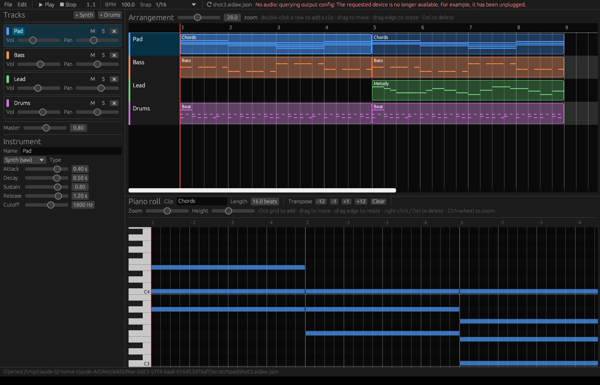

# AIDAW 🎹 —— 哼，给杂鱼准备的 AI 作曲 DAW

> 欸～连和弦都不会写的笨蛋也想做音乐？
> 真拿你没办法……那就让 AI 帮你写，你只要在旁边动动鼠标改改就行了♡
> 才、才不是特意为你做的！只是刚好 Windows 11 上能跑而已！

**AIDAW** 是一个跑在 Windows 11 上的 **AI 驱动 DAW**：AI 通过 [MCP](https://modelcontextprotocol.io) 工具（或者命令行）读写工程、作曲、渲染；你在 GUI 里**实时**看着 AI 一步步改你的歌，不满意就精调，或者直接 `Ctrl+Z` 把它的改动扔掉。



## 现在都能干嘛（给不看代码的杂鱼的速览）

| 功能 | 一句话 |
|---|---|
| 🐣 Easy / 🔧 Pro 开关 | 左上角的大开关。新手默认 Easy，只留必要按钮；觉得自己行了再切 Pro。切换只改界面，不碰你的歌 |
| 🔁 自动循环 | 播放到最后一个音符所在小节结尾就自动绕回开头，杂鱼不用手忙脚乱按停止 |
| ▶️ 从哪儿播都有声 | 从长音、和弦中间开始播放也马上能听到（20 ms 淡入，不会「啪」一声），不用傻等下一个音符 |
| ⚡ 不卡音的引擎 | 音频回调里不加锁、不分配内存，界面再忙也卡不出爆音。哼，本小姐写的引擎才不会掉链子 |
| 🤖 任何 LLM 都能用 | `aidaw-mcp.exe`：20 个 MCP 工具，外加 CLI（`call` / `tools --format openai` / `guide`），Claude、GPT、Gemini、Ollama 都行 |
| 🛡️ AI 不会乱来 | MCP 的相对路径一律相对工程目录，只允许写 `*.aidaw.json` 和 `*.wav`；GUI 和 AI 同时改也不会丢改动 |
| ✨ 好看的界面 | 深色主题、LCD 风格走带、会发光的按钮，内置 Inter 字体 |
| 📐 自适应布局 | 两行顶栏、钢琴卷帘按窗口比例缩放，小窗口（900×600）也不挤 |
| 🌏 EN / 中文 | 顶栏右侧一键切换；首次启动跟随系统语言。内置 Noto Sans SC 子集，不靠系统字体 |
| 🎛️ 78 个音色 + 7 套鼓组 | 10 个分类标签页，从电钢到 808 到 8-bit，挑到你满意为止（反正你也挑不出毛病吧？） |
| 🌌 混响 | 每条轨道一个「混响」滑块，所有轨道共用一个房间（Pro 模式还能调房间大小和音色）。新轨道按音色自动给一点，贝斯默认干声。杂鱼的歌终于不那么干巴巴了♡ |
| ✂️ 像样的编辑 | 按住 `Shift` 拖个框就能选中一堆音符：`Ctrl+C` / `Ctrl+V` 复制粘贴、`Ctrl+D` 重复、方向键挪位置和升降音高（按调内音走，乱按也不跑调）、`Q` 量化。片段也能 `Ctrl+C` / `Ctrl+V` / `Ctrl+D`。终于不用一个一个点了吧，杂鱼♡ |
| 💬 聊天 AI 直接粘贴 | 什么都不用装：让随便哪个聊天 AI（ChatGPT、Gemini、DeepSeek…）用 JSON 列出音符，复制它的整段回答，点一个片段按 `Ctrl+V`，音符就进来了。现成的提示词在「问 AI」里 |
| 🔊 主总线限幅器 | 峰值限幅 + 软削波，杂鱼把音量推爆也不会炸耳朵 |
| ↩ 撤销一切 | AI 的改动、你的改动，全都能 `Ctrl+Z` |

## 快速上手

### 0. 拿到程序

- **懒人**：去 GitHub Actions 最新一次 CI 下载 artifact `aidaw-windows-x64`，里面有 `aidaw.exe`、`aidaw-mcp.exe` 和 demo 工程。
- **想自己编译的**：看下面的「构建」。哼，看你能不能编过。

### 1. 打开 GUI

双击 `aidaw.exe`，或者带上 demo：

```powershell
aidaw.exe examples\demo.aidaw.json
```

第一次打开会有欢迎页，可以选：

- **2 分钟互动教程**：一步步教你播放、画音符、换音色，做对了自动进下一步。连杂鱼都能跟上的那种♡
- 播放 demo / 新建空白歌曲
- 3 步把 Claude 接进来

之后随时在 **❓ Help** 菜单里重开。

### 2. Easy 和 Pro 到底差在哪

- **🐣 Easy**（默认）：大按钮选音色；用「心情」（Happy / Sad / Can't go wrong / Bluesy）代替调式，**音符永远在调内**，乱点也好听；长度按小节算；顶栏直接有 ↩ Undo / ↪ Redo 和 ✨ Ask AI。
- **🔧 Pro**：网格、声像、Solo、力度、缩放，以及音色微调（ADSR、滤波、共振、滤波包络、FM、Unison、Sub、颤音、失真……）。高级参数默认折叠，怕你一打开就晕。

**Key + Stay in key** 会高亮调内音并把音符自动吸附过去。点钢琴键能直接试听，画音符时也能听到声音。每个按钮都有悬停说明，看不懂就把鼠标停上去，笨蛋。

### 3. 音色

内置 **78 个音色**，分 10 组标签页：

键盘（电钢、风琴、羽管键琴…）· 贝斯（808、Acid、Reese…）· 主音 · Pad · 拨弦/吉他 · 钟琴/马林巴 · 管弦（弦乐、铜管、长笛、萨克斯…）· 复古 8-bit · 音效（Riser、Zap…）· 鼓组

**7 套鼓组**：标准 / 808 / 909 / 原声 / Lo-fi / Trap / Electro，全都带牛铃、沙锤、康加等打击乐。

### 4. 快捷键（背下来，不许问第二遍！）

| 操作 | 怎么做 |
|---|---|
| 播放 / 暂停 | `空格` |
| 定位播放头 | 点编排区的标尺 |
| 新建 clip | 编排区双击空白处 |
| 移动 / 改长度 / 删除 clip | 拖动 / 拖右边缘 / 点一下再按 `Del` |
| 复制 clip | 点一下再按 `Ctrl+D`，接在它后面复制一份（后面被占了就放到下一个空位）；`Ctrl+C` / `Ctrl+V` 粘到播放头所在的小节；`←` / `→` 挪一小节 |
| 画音符 | 钢琴卷帘里点击或拖拽空白处 |
| 选中多个音符 | 按住 `Shift` 在空白处拖个框；`Ctrl+点击` 加选 / 取消；`Ctrl+A` 全选；`Esc` 全不选 |
| 改音符时间、音高 / 时值 | 拖动音符（选中的会一起走）/ 拖右边缘 |
| 复制 / 剪切 / 粘贴音符 | `Ctrl+C` / `Ctrl+X` / `Ctrl+V`：粘到播放头所在的小节，在小节里的位置不变 |
| 重复音符 | `Ctrl+D`：比半小节长的按整小节往后重复，短的按拍（再短就按网格） |
| 挪位置 | `←` / `→` 一格网格，按住 `Shift` 一整个小节 |
| 升降音高 | `↑` / `↓`：Easy 模式和开了「保持在调内」的 Pro 模式按调内音走一步，否则走半音；按住 `Shift` 一个八度 |
| 量化 | `Q`：把选中音符的开头对齐网格，什么都没选就整段对齐 |
| 删除音符 | 右键，或者选中后按 `Del` |
| 缩放 | `Ctrl+滚轮` |
| 撤销 / 重做 | `Ctrl+Z` / `Ctrl+Y` |
| 保存 | `Ctrl+S`（其实 GUI 改完 300ms 就自动存了） |
| 导出音频 | File → Export WAV |

## 让 AI 帮你作曲

### Claude Desktop（或任何 MCP 客户端）

编辑 `%APPDATA%\Claude\claude_desktop_config.json`：

```json
{
  "mcpServers": {
    "aidaw": {
      "command": "C:\\path\\to\\aidaw-mcp.exe",
      "args": ["--project", "C:\\Music\\song.aidaw.json"]
    }
  }
}
```

然后在 GUI 里打开**同一个**文件，对 AI 说：「写一段 100 BPM 的 lo-fi，Am-F-C-G，加鼓和贝斯」。它写的东西会实时出现在 GUI 里。看，比你自己写快多了吧～

Claude Code / Cursor / Windsurf / Cline 等 MCP 客户端配置方式同理。

### 不支持 MCP 的 LLM？也行啦

- **函数调用 API**（OpenAI / Gemini / Anthropic / Ollama…）：先导出工具定义，再执行调用
  ```powershell
  aidaw-mcp tools --format openai      # 也可以 anthropic / gemini
  aidaw-mcp call add_chords '{"track":"Piano","chords":"Am F C G"}' --project song.aidaw.json
  ```
- **只能跑命令的 agent**：直接用 `key=value` 参数
  ```powershell
  aidaw-mcp call add_chords --project song.aidaw.json track=Piano chords="Am F C G"
  ```
- **普通聊天 AI**：`aidaw-mcp guide` 打印一页速查表，整页贴给它就行
- **连命令都懒得敲**：点「问 AI」，展开「什么都不想装？从任何聊天 AI 粘贴音符」，复制里面的提示词发给聊天 AI，再把它的回答整段复制，回 GUI 点一个片段按 `Ctrl+V`。它认 `[{"pitch":"A4","start":0,"duration":1}]` 这样的列表，前后的废话和 ```` ``` ```` 代码块都会自己剥掉。AI 写得烂？`Ctrl+Z` 扔掉就好♡

完整说明见 [docs/LLM_GUIDE.md](docs/LLM_GUIDE.md)。

### 20 个 MCP 工具

- **音乐级**（模型不用自己算音符，对小模型很友好）：
  - `add_chords`：`"Am F C G"`
  - `add_drum_pattern`：`{"kick":"x...x...","snare":"....x..."}`
  - `add_melody`：`"C4/1 D4/0.5 r/1 G4/2"`
- **工程**：`help`、`new_project`、`open_project`、`get_project`、`list_presets`、`update_project`、`render_wav`
- **底层编辑**：`add_track` / `update_track` / `remove_track`、`add_clip` / `update_clip` / `remove_clip`、`add_notes` / `remove_notes` / `transpose_clip`、`apply_ops`（原子批量）

对笨笨的小模型也很宽容：轨道 / clip 可以用名字引用，数字写成字符串也认，乐器可以直接写预设名（`"bass"`、`"Warm Pad"`），位置可以用小节（`bar: 5`）；每个错误都会列出合法值并附一个示例调用。

`examples/demo.aidaw.json` 就是通过 MCP 接口生成的 4 轨 demo。

## 它是怎么运作的（给想看原理的杂鱼）

```
            ┌──────────────┐  stdio JSON-RPC (MCP)  ┌────────────────┐
 Claude 等 ─┤  aidaw-mcp   ├──────── 读/写 ────────►│ song.aidaw.json│
  AI 客户端  └──────────────┘                        └───────┬────────┘
                                                    文件监听 │ 自动保存
                                                  ┌─────────▼────────┐
                                    人 ◄────────► │  aidaw (GUI)      │
                                                  │  egui + cpal 播放 │
                                                  └──────────────────┘
```

| crate | 作用 |
|---|---|
| `aidaw-core` | 工程数据模型（JSON）、编辑操作 `Op`、内置合成器/鼓机、音序器、主总线限幅、离线渲染 WAV |
| `aidaw-engine` | 实时播放：cpal → Windows 上走 WASAPI，音频回调里跑同一个音序器；回调不加锁、不分配内存，和界面之间只走无锁命令队列和原子变量 |
| `aidaw-gui` | 桌面编辑器（`aidaw.exe`）：编排时间线、钢琴卷帘、轨道/混音、乐器参数、撤销重做、主题（`theme.rs`）、中英文（`i18n.rs`） |
| `aidaw-mcp` | MCP 服务器 + CLI（`aidaw-mcp.exe`）：让 AI 新建/打开工程、加轨、写音符、批量编辑、渲染 |

**协作模型**：工程就是一个 `.aidaw.json` 文件。

- MCP 每次调用都「读 → 改 → 原子写回」，写回前发现文件被 GUI 改过，就在新版本上重放这次编辑。
- GUI 轮询文件，发现外部修改就热重载，并把重载前的版本压进撤销栈，所以 AI 的任何改动按 `Ctrl+Z` 就能撤回。
- GUI 里的修改 300ms 后自动保存，AI 下次调用就能读到；若保存时发现 AI 刚写过，保留你的版本并把 AI 的版本放进撤销栈。谁的改动都不会悄悄丢，放心啦。

**安全**：MCP 收到的相对路径一律相对于工程所在目录（没打开工程时是 Music 目录），且只会写 `*.aidaw.json` 和 `*.wav`。AI 写错路径也覆盖不了别的文件，哼，本小姐可是考虑周全的。

**单位**：时间一律是**拍**（四分音符）。clip 的 `start` 是绝对拍位置，note 的 `start` 是相对 clip 的拍位置。音高可以写 MIDI 数字或音名（`"C4"` = 60）。

## 构建（Windows 11）

1. 安装 Rust：<https://rustup.rs>（默认 MSVC 工具链，需要 VS Build Tools 的「C++ 生成工具」）
2. 编译：
   ```powershell
   cargo build --release
   ```
3. 产物：`target\release\aidaw.exe`、`target\release\aidaw-mcp.exe`

提 PR 之前自己先跑一遍，别让 CI 替你丢人：

```powershell
cargo fmt --all --check
cargo clippy --workspace --all-targets -- -D warnings
cargo test --workspace
```

CI（GitHub Actions，`windows-latest`）每个 PR 都会跑上面这些，并上传两个 exe 作为 artifact。加了新的界面文字或音色？记得在 `i18n.rs` 里补中文翻译，不然测试 `every_string_is_translated` 会骂你的♡

## 路线图（本小姐接下来要做的事）

- [ ] 插件宿主：VST3 / CLAP 乐器与效果器
- [ ] 音频轨与录音、采样器
- [x] 混响：每轨发送量 + 共用房间（大小 / 音色）
- [ ] 自动化包络、效果器链（EQ / 压缩）
- [ ] ASIO 低延迟驱动、导出 MIDI
- [x] 多选、复制粘贴、重复、量化，还能直接粘贴聊天 AI 写的音符
- [ ] 可自定义循环区
- [x] 音频回调零分配、引擎与 UI 之间改为无锁命令队列
- [ ] AI 侧：`render_wav` 后回传音频分析（响度/频谱），让 AI 能「听」自己的作品

## 许可证

AIDAW 用 [MIT 许可证](LICENSE)，随便用、随便改、拿去卖钱都行，只要保留版权声明和协议原文就好。出了事不许赖本小姐哦♡

内嵌在程序里的两套字体是别人家的，走 SIL Open Font License 1.1，协议原文在这里，分发的时候要一起带上，别弄丢了笨蛋：

- Inter：[`crates/aidaw-gui/assets/Inter-LICENSE.txt`](crates/aidaw-gui/assets/Inter-LICENSE.txt)
- Noto Sans SC（子集）：[`crates/aidaw-gui/assets/NotoSansSC-LICENSE.txt`](crates/aidaw-gui/assets/NotoSansSC-LICENSE.txt)

---

> 好啦，说明书写到这么细了，要是还不会用……那就真的是无可救药的杂鱼了呢♡
> ……有问题的话，也、也不是不可以来问啦。
